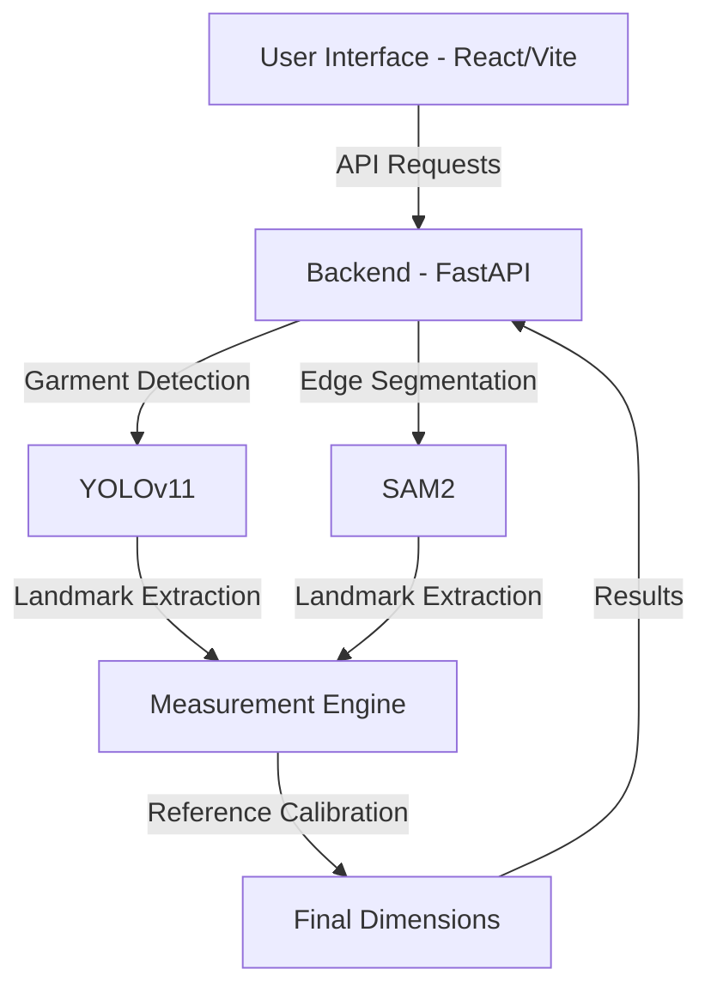

# MECO - AI-Powered Garment Measurement Agent

Accurate garment measurement is important in the apparel industry to maintain consistent quality, ensure proper fit, and reduce defects. Manual measurement methods are slow, depend on skilled workers, and often lead to human errors, which affect quality control.

**MECO** (Measurement Co-Pilot) is an intelligent system designed to automatically measure garments accurately and consistently without manual effort. It leverages artificial intelligence, computer vision, and deep learning to extract precise dimensions from images in real time, significantly improving efficiency in the apparel industry.

## 🏗️ Proposed Solution

This project presents an automated garment measurement system that:
1.  **Garment Detection:** Uses a custom-trained object detection model (YOLOv11) to identify garments in input images.
2.  **Masking & Segmentation:** Employs Image Segmentation models (SAM2) to generate pixel-perfect masks.
3.  **Landmark Identification:** Identifies key garment landmarks such as shoulders, chest, neckline, and hem through keypoint detection.
4.  **Reference-Based Calibration:** Utilizes a reference object with known dimensions for camera calibration, enabling precise pixel-to-centimeter conversion for real-world accuracy.
5.  **Automated Calculation:** Automatically computes dimensions including:
    *   **Chest Width**
    *   **Shoulder Width**
    *   **Garment Length**
    *   **Sleeve Length**
    *   **Neckline**

The system is designed to be scalable and user-friendly, allowing seamless integration with modern applications for real-time measurement analysis.

## 🛰️ System Architecture



## �️ Tech Stack

-   **Frontend:** React 19, Vite, Bootstrap, Lucide React, Axios.
-   **Backend:** FastAPI, Python, Ultralytics (YOLOv11), Segment Anything Model 2 (SAM2).
-   **Computer Vision:** YOLO for detection, SAM2 for segmentation, and custom landmark extraction logic.

## 🚀 Getting Started

### 1. Backend Setup (FastAPI)

Prerequisites: Python 3.11+, `uv` (recommended) or `pip`.

```bash
cd backend

# Set up environment
uv venv --python 3.11
source .venv/bin/activate # On Windows: .venv\Scripts\activate

# Install dependencies
uv pip install -r requirements.txt

# Models should be placed in backend/models/
# Required: yolo11n-dress.pt, sam2_l.pt
```

### 2. Frontend Setup (React + Vite)

Prerequisites: Node.js 18+.

```bash
cd frontend

# Install dependencies
npm install

# Run development server
npm run dev
```

## 📸 Sample Output


## 📄 License

This project is proprietary. All rights reserved.
